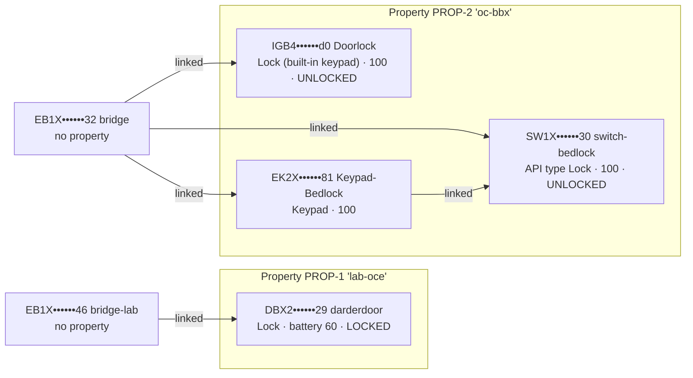

# Device and Bridge Topology — Test Site

Date: 2026-09-25 · Status: **physical/app topology from user; API topology not yet observed.**
Evidence labels as in [research README](../research/igloohome/README.md#evidence-labels). Plus: **PHYS** = confirmed physically by user, **APP** = confirmed in the igloohome mobile app by user.

## 0. API view (EXP-20260925-01, 2026-09-25) — supersedes the guesses below



| Question | Answer (API) |
|---|---|
| T1 prefixes / types | EB1X Bridge ×2, DBX2 Lock, IGB4 Lock, **EK2X** Keypad (not in docs table), **SW1X typed `Lock`** |
| T2 built-in keypad separate? | **No** — IGB4 appears once |
| T3/T5 which keypad links where | EK2X → SW1X (bedlock); Bridge `bridge` lists EK2X, SW1X, IGB4 |
| T4 switch representation | type `Lock`, battery 100, `lockStatus` UNLOCKED, not in `support-pins` |
| T6 algoPIN-capable (API) | DBX2, IGB4, EK2X |
| T7 properties | 2, both Asia/Jakarta; Bridges have none |
| T8 lock ↔ Bridge link | Visible on the **Bridge** record only; lock records have `linkedDevices: []` |
| New | Second Bridge + DBX2 lock in "lab-oce" — **user confirmed: test devices, a separate room behind its own Bridge** (useful to show room separation). Internal `id` not unique → key on `deviceId` |
| T9 app view | **Matches the API view (user, 2026-09-25)** |

## 1. What the user reports (PHYS / APP)

1. One **Bridge**, connected to the available devices.
2. One **door lock**, connected to the Bridge.
3. The door lock has a **built-in keypad**.
4. A **separate linked keypad** configuration.
5. A **keypad-related configuration connected to the Bridge**.
6. One **switch**, controllable from the mobile app.
7. **Keypad readers connected to the switch**, used for an internal **bedlock**.

Items 4, 5 and 7 may describe overlapping hardware. The count of physical keypads and which device each is linked to must be recorded in E3b.

## 2. Known topology (as reported, not API-verified)

```mermaid
flowchart LR
  subgraph Cloud
    API[igloohome API]
  end
  BR[Bridge EB1X?]:::unverified
  DL[Door lock<br/>built-in keypad<br/>prefix ?]:::unverified
  KP[Linked keypad<br/>EK1X?]:::unverified
  SW[Switch SW1X?<br/>bedlock]:::unverified
  KR[Keypad reader(s)<br/>for bedlock]:::unverified
  API -- Wi-Fi/MQTT --- BR
  BR -- BLE --- DL
  BR -. "keypad config (APP)" .- KP
  KP -. "linked? (APP)" .- DL
  KR -. "connected (APP)" .- SW
  SW -. "via Bridge? unknown" .- BR
  classDef unverified stroke-dasharray: 4 3
```

Dashed = relationship not confirmed through the API. Prefixes with `?` are guesses from the supported-devices table (EB1X = Bridge, EK1X = Keypad, SW1X = Switch) and must be replaced by what `GET /devices` returns.

## 3. Component model and verification status

| Component | Our concept | Likely API representation | Documented capabilities (DOC) | Verification status |
|---|---|---|---|---|
| Bridge | Connectivity hub | `type: "Bridge"`, prefix `EB1X`; `homeId` may be absent (Stoplight: Bridges may have no property) | Targeted diagnostics job 10 (Wi-Fi, `locksCurrentAdded`, `locksMaxCapacity`, `lockRssiList`); relays proxied jobs; online/offline webhook | PHYS/APP ✓ · API ✗ (E3, E6) |
| Door lock | Access point for a door | `type: "Lock"`, prefix unknown | If algoPIN-capable: algoPIN; via Bridge: jobs 1, 2, 4, 5, 9, 10, 15; `lockStatus` only if Bridge-linked; master PIN | PHYS/APP ✓ · API ✗ (E3, E7, E8) |
| Built-in keypad | Part of the door lock | **Not a separate device** (HYP) — it is the lock's own keypad | PINs entered here are validated by the lock | PHYS ✓ · API ✗ (E3: confirm no separate device appears) |
| Linked keypad | Separate PIN entry device | `type: "Keypad"`, prefix `EK1X` (or EK2 per SDK), with `linkedDevices` → lock or switch | algoPIN **Yes** (supported-devices); master PIN (Lock and Keypad only); link/unlink via SDK only | APP ✓ · API ✗ (E3, E3b) |
| Switch | Actuator for the bedlock | Prefix `SW1X` is listed under **Locks** in the supported-devices table, but documented `type` values are only Lock/Keypad/Bridge/Fob → actual `type` **unknown** | algoPIN **No**. Only other mention: SDK notes battery is not pushed to the server for Switch-type devices. **No documented REST or Bridge operation specific to the switch** | APP ✓ · API ✗ · behaviour **NF** |
| Keypad reader(s) on switch | PIN entry for bedlock | Possibly `type: "Keypad"` linked to the switch (HYP) | If EK1X: algoPIN Yes | APP ✓ · API ✗ · **NF** |
| Internal bedlock | Physical latch driven by the switch | Not an igloohome device (HYP) | None | PHYS ✓ only |
| Provider device ID | `deviceId` (12-char Bluetooth name: prefix+batch+unique) | DOC | Used in every path | — |
| PMS room / bed asset | **Not introduced in slice 1** | — | — | — |

Key facts to keep in mind:
- The API topology is **lock-centric**: relationships appear as `linkedDevices` on each device record. There is no endpoint listing a Bridge's devices (NF); the Bridge diagnostics job only returns counts and RSSI.
- A device linked to the Bridge in the app is not guaranteed to accept proxied jobs. `406 "Lock is not linked to bridge"` (Stoplight) is the documented signal.
- Whether the **switch** can be triggered remotely (e.g. by proxied job 2 "Unlock") is **not documented**. Slice 1 will **not** try it. E3 records how the switch appears; the question goes to igloohome support.

## 4. Questions E3 / E3b must answer

| # | Question | How |
|---|---|---|
| T1 | Exact prefixes and `type` of every device | `GET /devices` (all pages) |
| T2 | Does the built-in keypad appear as its own device? | Compare device count with physical count |
| T3 | Which device(s) list the linked keypad in `linkedDevices`? | `GET /devices/{id}` for each |
| T4 | How is the switch represented (`type`, `linkedDevices`, battery, `lockStatus`)? | `GET /devices/{switchId}` |
| T5 | Are the bedlock keypad readers separate devices, and linked to the switch? | as T3 |
| T6 | Which devices are algoPIN-capable per the API? | `GET /devices/support-pins` |
| T7 | Which property (and timezone) each device belongs to? | `homeId` + `GET /properties` |
| T8 | Is the door lock linked to the Bridge at API level? | `linkedDevices`; then E7 (406 check) |
| T9 | What does the mobile app show for the same devices? | Operator records app names/relationships in `test-site-topology.yaml` |

## 5. Mapping to future PMS assets (not built in slice 1)

The PMS model must not copy the vendor hardware model. Expected mapping, to be confirmed after E3/E3b and Slice 2 design:

| PMS asset (future) | Access point | Provider devices (candidate) | Open question |
|---|---|---|---|
| Room / cabin door | Door access | Door lock (+ built-in keypad) | Which credential type (Slice 2) |
| Bed / capsule | Bed access | Switch + keypad reader(s) | **Is it manageable via API at all?** If not, bed access stays app-managed or needs other hardware |
| Site / property | — | igloohome property (`homeId`) | 1:1 with Bobobox property? |
| Infrastructure | — | Bridge | Health monitoring only |

A PMS "access point" should be able to map to **one or more** provider devices (e.g. a door lock and a linked keypad share one PIN domain), and a provider device may exist with no PMS asset (the Bridge). This is why a separate mapping table is planned for Slice 2 instead of storing room IDs on device records.

## 6. Redaction rule for committed topology

Commit only redacted IDs: first 4 characters (model prefix) + `••••••` + last 2 characters, e.g. `EB1X••••••7c`. Full IDs live only in the local Postgres database (device registry, plan F7); the old `.env` allowlist is deprecated.
